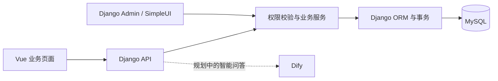
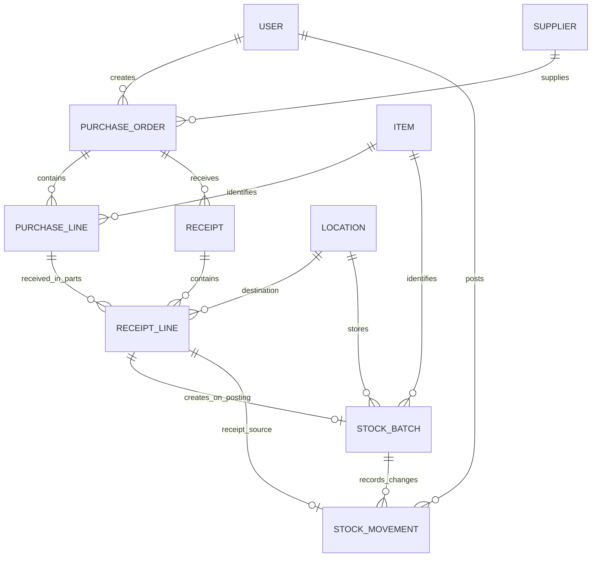
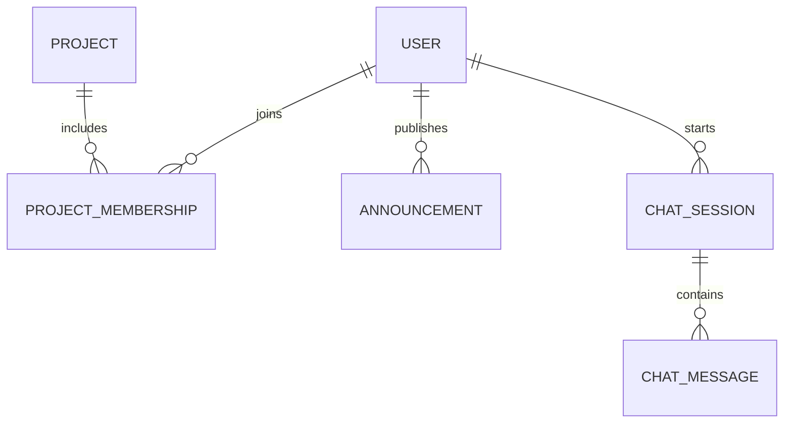

# 实验室管理系统：总体设计与开发指引

版本：0.2；更新日期：2026-11-14。面向共同开发的成员，说明系统要做什么、各部分如何关联、代码从哪里接着写。

本文整理用户提供的四张页面草图和四张 ER 图。图片表达的是设计目标，不能据此判断代码已经完成；实际完成情况以 [开发进度](11-development-status.md) 为准。手写划除、模糊旁注和布局顺序不作为最终要求。

## 1. 先读哪些文档

| 想了解什么 | 阅读位置 |
| --- | --- |
| 整体目标、业务模块和数据关系 | 本文 |
| 已完成什么、还差什么、下次从哪里继续 | [开发进度](11-development-status.md) |
| 页面草图如何落成前端页面 | [前端设计](02-frontend-design.md) |
| Vue、Django、MySQL 如何配合、代码目录 | [架构与阅读路线](03-architecture.md) |
| 启动本机环境 | [本地开发](01-local-development.md)、[本机环境补充](08-local-environment.md) |
| 字段、外键、确认入库的事务逻辑 | [采购批准与确认入库](10-stock-receipt.md) |
| 前后端目前能调用什么 | [API 约定](05-api.md) |
| 分工、PR 和验收 | [后续任务](06-team-backlog.md)、[Git 协作](04-git-collaboration.md) |

## 2. 设计资料来源

以下文件名用于对应原始聊天附件；本文已将关键内容整理成文字和关系图，不依赖成员电脑上的下载目录。

| 原图 | 文件名 | 主要内容 |
| --- | --- | --- |
| 页面草图：首页 | `Image_1794302548440_174.jpg` | 导航、通知、快捷入口、登录、科研项目与 Dify 构想 |
| 页面草图：物品与采购 | `Image_1794302550567_636.jpg` | 材料/器材切换、库存列表、采购单与采购明细 |
| 页面草图：收货 | `Image_1794302553620_328.jpg` | 收货单、本次实收、厂家批号、有效期、库位、打印 |
| 页面草图：问答与个人页 | `Image_1794302556078_713.jpg` | 智能问答布局、历史会话、个人信息和改密 |
| ER 01/04：全局 | `file_000000008a9c82129476b906a7a18764.png` | 用户、采购、收货、库存、借还、科研项目和问答的主要关系 |
| ER 02/04：采购与收货 | `file_00000000cd0c82129df26b88e903fc8a.png` | 供应商、采购单/明细、审批记录、分批收货 |
| ER 03/04：库存与借还 | `file_0000000028208212a11800cadc19e2dd.png` | 批次、库位、流水、领用/借用、分次归还与来源追溯 |
| ER 04/04：用户与其他模块 | `file_00000000c7a482128fb89143d1ddad0f.png` | 用户资料、项目成员角色、公告、问答会话与消息 |

## 3. 系统目标与模块边界

系统围绕实验室物品的采购、收货、库存、领用和归还，记录物品从哪里来、放在哪里、由谁使用、每次数量为什么改变。科研项目、公告和智能问答在此基础上提供协作和查询能力。

| 模块 | 负责的事情 | 对应页面 |
| --- | --- | --- |
| 基础资料 | 物品名称/规格/单位、材料或器材分类、库位、供应商 | 器材与材料、后台基础维护 |
| 采购 | 采购单头、明细、价格、审批及状态 | 采购管理 |
| 收货 | 关联原采购明细，登记每次实收、厂家批号、日期、库位 | 收货入库 |
| 库存 | 批次余额、变动流水、按物品和库位查询 | 库存列表、流水查询 |
| 领用/借用与归还 | 按批次出库、关联使用人、追踪待还和分次归还 | 领用、借用、归还页面，布局待细化 |
| 用户与权限 | 登录、个人资料、平台角色、操作权限 | 登录、个人中心、后台用户管理 |
| 科研项目 | 项目登记、成员参与关系、项目内角色 | 科研项目页，布局待细化 |
| 公告 | 发布通知并在首页展示 | 工作台首页、后台公告管理 |
| 智能问答 | 会话、历史消息、有权限的数据查询、Dify 接入 | 智能问答 |

技术栈为 Vue + Django + MySQL，单仓库开发。Vue 通过 HTTP API 访问 Django，Django 使用 ORM 访问 MySQL。Django Admin + SimpleUI 是当前可用的业务操作入口；前端页面与 API 完成后，应复用相同业务服务。

这张图表达整体目标。当前采购/收货只接通 Admin → 服务 → 数据库；Vue 对应 API 尚未提供。

## 4. 采购、收货和库存：数据如何关联

以下是已落地的主要关系。`||` 表示一个，`o{` 表示零到多个，`o|` 表示零或一个。草稿可以没有明细，但批准或确认入库时不允许空单。

| 实体 | 当前模型 | 主要字段或作用 |
| --- | --- | --- |
| 物品档案 | `inventory.Item` | 编号、名称、类型、规格、基本单位；旧台账字段暂时保留 |
| 库位 | `inventory.StorageLocation` | 编码、名称、备注、启用状态 |
| 供应商 | `procurement.Supplier` | 编码、名称、联系人、电话、地址、启用状态 |
| 采购单 | `procurement.PurchaseOrder` | 单号、供应商、制单人、日期、状态、批准人和时间 |
| 采购明细 | `procurement.PurchaseOrderLine` | 所属单据、物品、行号、数量、单价、备注；金额计算得到 |
| 收货单 | `procurement.Receipt` | 单号、采购单、收货日期、登记人、状态、入库确认人和时间 |
| 收货明细 | `procurement.ReceiptLine` | 所属收货单、原采购明细、库位、本次实收、厂家批号、生产/有效日期 |
| 库存批次 | `inventory.StockBatch` | 内部批次号、物品、库位、来源明细、单位快照、批次日期、当前数量 |
| 库存流水 | `inventory.StockMovement` | 批次、来源明细、变动类型、变动数量、记账人和时间 |

需要一直保持的关系和规则：

1. 一张采购单属于一个供应商，可以有多条采购明细、分多次收货。若同一次实收有不同厂家批号或库位，拆成多条收货明细。
2. 收货明细必须指向本张收货单对应采购单中的明细。累计已入库数量加本次数量不得超过原采购数量。
3. 首版每条已入库收货明细生成一个内部批次，不因厂家批号相同就合并批次；每个批次对应一个库位。
4. 单据主键 ID 用于关联，单号/物品编码/内部批次号用于展示和查询；厂家批号不要求全局唯一。
5. 数量和单价用 Decimal；采购/收货数量必须大于零，单价与库存余额不能小于零。
6. 保存草稿不动库存。确认入库时创建批次、记录流水、更新单据状态，整单处于同一事务。
7. 重复确认不重复记账。同一采购单的收货操作统一锁采购单父记录，防止并发超收。
8. 已批准采购单和已入库收货单在后台不可编辑；库存流水只读。撤销或冲销需要单独设计，不能通过直接改余额、删除历史代替。

当前 `Item.quantity/location/expires_on` 仍供原始台账页面使用。新库存以批次余额为依据；下一步需要处理期初数据并增加汇总接口，不能直接把旧数量与新批次数量相加。

## 5. 领用、借用与归还：尚未实现的设计

按 ER 图，后续增加领用/借用单及明细、归还单及明细。模型名称暂可使用 `Issue`、`IssueLine`、`Return`、`ReturnLine`，这是命名建议，当前代码中尚不存在。

| 关系 | 业务含义 |
| --- | --- |
| 用户 1:N 领用/借用单 | 记录谁使用物品，同时区分领用人和经办人 |
| 领用/借用单 1:N 明细 | 一张单可以使用多种物品或多个批次 |
| 库存批次 1:N 出库明细 | 每条出库明细指定一个批次，不能只记录物品名称 |
| 原领用/借用单 1:N 归还单 | 允许多次归还，一张归还单对应一张原单 |
| 原出库明细 1:N 归还明细 | 每次归还可追溯到原出库批次及数量 |
| 归还单 1:N 归还明细 | 同次归还可以包含原单的多条物品 |

确认出库应在事务中校验可用余额、扣减批次、写负数流水；确认归还应校验累计归还量不超过原出库量，按首版规则归还原批次并写正数流水。同一归还明细指向的出库明细必须属于归还单对应的原单。

ER 图要求每笔流水来自收货、出库、归还中的一种来源，每条来源明细最多记账一次。**当前流水只实现必填的收货来源和正数入库约束。** 开发借还时必须同步扩展来源关系、互斥约束、数量方向和并发保护，不能只加类型枚举。

领用是否允许退回、借用期限、逾期提醒、损坏归还如何处理，尚需业务讨论，不能把耗材领用一律当作必须归还的借用。

## 6. 用户、项目、公告和问答：设计目标

此图除基础用户外均为待开发内容。

- **用户**：复用现有 `accounts.User` 和 Django 密码处理，不另建一套密码表。ER 中的邮箱、姓名等部分信息已有 Django 字段支持；电话、头像、性别、出生日期、专业、年级及自助资料编辑需按实际需要扩展。
- **平台权限**：Django 组/权限已经可用，但管理员、教师、负责人、成员的业务权限矩阵尚未确定。`is_staff` 仅表示后台访问资格，不等于教师或项目负责人。
- **科研项目**：项目名称、简介、状态、登记时间。用户与项目是多对多，通过成员关系保存项目内角色和加入时间；同一用户在不同项目可有不同角色。项目是否关联采购预算、领用用途需要另行确认。
- **公告**：标题、正文、发布人、发布时间，供首页读取；发布和撤回权限需明确。
- **问答会话**：归属用户、标题、创建时间、Dify 会话标识。会话下保存多条消息，记录发送方、内容和时间。外部会话标识不能代替本系统主键。
- **Dify 接入**：由 Django 调用，密钥保留在后端；先提供有权限的数据查询与答案来源，历史会话按用户隔离。涉及库存写入的自动操作不在当前实现范围。

采购审批记录是 ER 中另一张尚未落地的表，需记录采购单、审批人、结果、时间，建议补充意见。当前单头的批准人/时间只支持简单单级批准，不代替完整审批历史。

## 7. 页面草图到开发任务的对应

| 页面 | 草图期望 | 当前实现与下一步 |
| --- | --- | --- |
| 首页 | 通知、快捷入口、公共搜索、中英切换 | 基础布局/导航/健康状态可用；公告数据、全局搜索和双语待做 |
| 器材与材料 | 分类、查询、数量、库位、领用归还 | 已有基础台账列表/新增；待切换真实库存汇总并增加借还入口 |
| 采购管理 | 单号搜索、新建、编辑、审批、关联收货、打印 | Admin 已有模型和批准；Vue 页面与业务 API 待做 |
| 收货入库 | 采购关联、实收、批号、日期、库位、打印 | Admin 已有分批收货和确认入库；Vue 页面与业务 API 待做 |
| 智能问答 | 主对话区、输入框、历史会话 | 只有占位入口；服务、数据表、接口均待做 |
| 个人中心 | 资料查看/编辑、头像、改密 | 仅展示基本账号信息；资料维护与改密接口待做 |
| 科研项目 | 项目登记、项目成员及角色 | ER 已有设计，数据表、页面与接口待做 |

原草图强调“列出页面需要的内容，不代表最终排序”。前端可以继续调整布局，但字段含义、权限和数据来源要与后端约定一致。采购“材料/器材”切换可以按物品类型筛选；是否禁止同一采购单混合类型尚未确定，当前没有采购单级别类型约束。

## 8. 开发顺序与协作约定

1. **库存查询与旧台账衔接**：约定物品总量、批次余额、库位和有效期的返回结构，处理期初库存，再接前端查询。
2. **领用/借用**：明确人员和权限、建单据和明细、扩展流水、实现扣库事务及并发测试。
3. **归还**：关联原单/原行，支持分次归还，验证累计上限及重复确认。
4. **业务权限与 API 联调**：角色设计在接口实现前确定；采购/收货现有服务可以先按约定接 API，前后端按模块并行。
5. **审批完善与协作模块**：补提交/驳回/取消/审批记录，再推进项目、公告、个人资料、问答。

打印导出、附件上传、中英切换、预警、设备逐台追踪、盘点/调拨/报损等作为后续议题，按需求确定范围。多实验室数据隔离、审批级数、无采购入库、供应商退货和冲销规则也尚未定稿。

每项开发先在 Issue 写清操作者、输入、状态变化、权限、失败情况和验收标准；采用功能分支与 PR。数据库模型与迁移一起提交，迁移冲突协商解决；页面和 API 复用业务服务，不各写一套入库逻辑。业务代码、迁移、测试、文档都进入 Git；凭据、数据库数据目录和本机备份不进入 Git。
