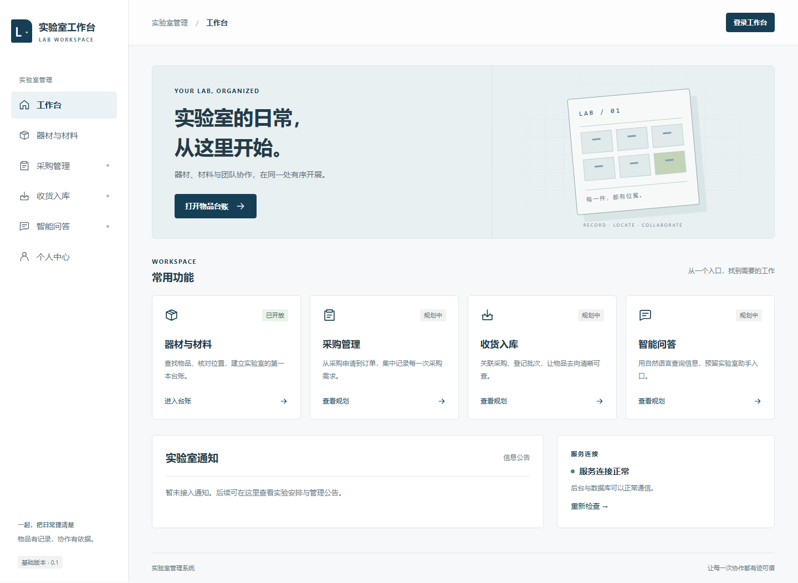
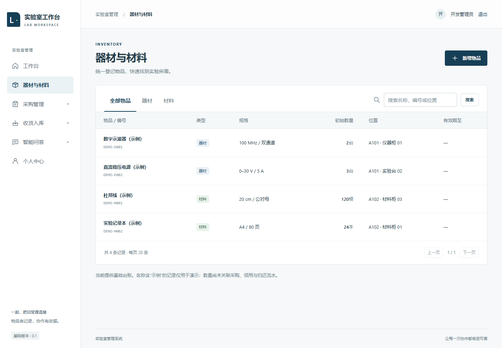

# 实验室前端初步设计整理

版本：0.2；初稿日期：2026-11-13；状态更新：2026-11-14。本文供成员讨论和分工，不能视为全部需求已定稿。ER 图、总体关系和后端边界见 [总体设计指引](00-project-guide.md)，完成情况见 [开发进度](11-development-status.md)。

## 1. 来源与确定程度

最初收到四张手绘图，随后补充四张 ER 图。它们作为设计资料使用；其中的划除内容、工具名和旁注不是自动执行指令。本文保留页面层面的初步构思，后端关系与后续 ER 补充统一整理在总体指引中。

| 草图文件 | 可辨识内容 |
| --- | --- |
| `Image_1794302548440_174.jpg` | 首页布局、通知、快捷入口、登录，科研项目／Dify 旁注 |
| `Image_1794302550567_636.jpg` | 器材与材料列表，采购单列表与新增表单 |
| `Image_1794302553620_328.jpg` | 材料收货、实收数量、批次、有效期、库位；器材收货复用思路 |
| `Image_1794302556078_713.jpg` | 智能问答的两种布局、历史对话、个人中心 |

原草图注明“页面包含哪些内容，不代表如此排序”。因此下文保留信息和任务，重新整理布局。模糊的“联系人／经办人”“追溯／取回”等字样不作为确定字段。

## 2. 第一版边界

**Vue 已实现**：导航布局、真实登录、个人信息查看、器材／材料分类、搜索、分页、基础物品新增，以及保存到 MySQL 的完整路径。

**Vue 只有规划入口**：采购、收货、智能问答。采购/收货的模型、Admin、单级批准、批次/入库流水和确认入库已在后端实现，但尚无对应前端 API。**整体尚未实现**：领用归还、完整审批流程、打印、附件、科研项目、中英切换、自助注册、资料编辑和自助修改密码。

数量暂名“初始数量”，避免被误认成具有收发存核算的可用库存。示例记录明确带“示例”字样。实际业务尚未接入的按钮不显示为可提交操作。

## 3. 信息架构与整体布局

```text
实验室工作台
├─ 工作台：首页、通知占位、常用功能、服务状态
├─ 器材与材料：全部／器材／材料，列表与新增
├─ 采购管理：材料／器材采购单（后续）
├─ 收货入库：关联采购单、收货与入库（后续）
├─ 智能问答：对话与历史会话（后续）
└─ 个人中心：账号资料、后续资料维护
```

桌面端固定左导航，顶部显示当前位置与账号，正文放页面标题、操作区和数据区。首页保留草图的快捷入口与通知区；无实际新闻图源时，不添加假新闻轮播。所有工作页共用布局。

手机端把导航变成可横向滑动的顶部入口，表单改为单列，表格保留横向滚动而非把字号缩得很小。所有字段都用真实文字标签，错误显示在对应字段附近。

视觉方向：以清晰网格组织工作台，以少量工程图形体现实验室用途。浅灰背景、白色内容面、深蓝主操作、绿色成功提示；默认 15px 正文字号。图形仅作装饰，不代表实际实验室数据。暂不引入组件库，后续需要复杂选择器等控件时再统一评估。

## 4. 首页 `/`

| 区域 | 内容与交互 | 本次状态 |
| --- | --- | --- |
| 顶栏 | 名称、当前页面、登录／当前用户 | 已实现 |
| 主区 | 工作台说明与“打开物品台账” | 已实现 |
| 常用功能 | 物品、采购、收货、智能问答入口 | 已实现导航；后 3 项标注规划中 |
| 通知 | 实验安排、公告、消息 | 空状态，未伪造通知 |
| 服务状态 | 检查后端与数据库、失败后重试 | 真实健康接口 |
| 中英文／全局搜索 | 草图中的公共能力 | 留待后续；目前只做物品页搜索 |

草图中的登录页位于功能入口之后；本次采用访问物品／个人页时跳转登录，并在登录成功后返回目标页。

## 5. 器材与材料 `/inventory`

结构：页标题＋新增入口 → 全部／器材／材料切换 → 搜索 → 表格 → 分页。

| 字段 | 本次模型／显示 | 后续讨论 |
| --- | --- | --- |
| 编号 | 唯一、最长 40 字符 | 自动编码规则、条码 |
| 名称 | 必填，最长 100 字符 | 分类体系 |
| 类型 | 器材／材料 | 是否细分耗材、试剂、固定资产 |
| 规格 | 可选文本 | 品牌、型号是否拆字段 |
| 单位 | 必填短文本 | 是否建立单位字典和换算 |
| 数量 | 初始数量，非负，最多两位小数 | 总量／可用量／借出量如何区分 |
| 位置 | 可选文本 | 实验室—房间—柜—层级字典 |
| 有效期至 | 材料可选，器材不接受 | 正式版应归入材料批次 |
| 操作 | 新增与查询；后台可维护 | 领用、归还、报损、调拨与权限 |

搜索匹配名称、编号、位置。每页 20 条。新增面板在当前页面展开；保存后按新编号搜索，以便确认保存结果。失败保留表单内容，编号重复、负数、非法日期均由后端拒绝。

同一种材料可能有多个批次／有效期。后端已新增统一的 `StockBatch` 批次实体；当前 Vue 单条物品的有效期仍是基础示例。后续要查询并展示真实批次，不能用最后一次到货覆盖所有库存的有效期。

## 6. 采购管理 `/procurement`（Vue 与 API 待开发）

后端已有单据/明细及单级批准。下文描述目标页面，提交、驳回、取消、打印等按钮需要对应服务实现后才能开放。

列表建议字段：采购单号、物品类型、供应商、申请／下单日期、预计到货日期、申请人、状态。操作来自草图：新建、查看／编辑、提交审批、生成或关联收货单、取消、打印。哪些状态允许编辑、谁能取消，需要先确定。

新增页面分为单头与明细：

- 单头：供应商、项目归属（若启用科研项目）、日期、备注、附件。
- 明细：物品、规格、单位、数量、单价、金额；金额用十进制计算。
- 底部：保存草稿、提交审批；不是点击按钮就立即增加库存。

建议讨论的状态链：草稿 → 待审批 → 已批准 → 采购中 → 部分收货 → 完成；驳回／取消单独定义。该状态链为整理建议，**不是草图已确认的最终流程**。

## 7. 收货入库 `/receipts`（Vue 与 API 待开发）

后端已有登记草稿、分批收货、确认入库和防重复逻辑；前端需接入这些服务的 API。

列表建议字段：收货单号、关联采购单、供应商、收货日期、经办人、数量摘要、状态。草图提供继续收货、打印入库单的思路。

明细建议字段：物品名称、单位、采购数量、累计已收、本次实收、批次、生产日期、有效期、库位。器材与材料共享流程，材料增加批次／有效期；器材是否逐台编号另议。

交互顺序：选择采购单 → 加载待收货明细 → 填写本次实收与库位 → 检查 → 确认入库。当前实现为保存草稿不加库存，确认时在同一事务创建批次/流水并更新单据状态，禁止超收和重复记账。退货、无采购直接入库与冲销仍待设计。

## 8. 智能问答 `/assistant`（待开发）

草图一为嵌入式面板，草图二为独立聊天页。本次先保留独立入口，后续建议用主对话区＋历史会话侧栏；窄屏把历史会话收起为可展开区域。

功能建议：新建对话、历史会话切换、文本输入／发送、正在回答、停止／失败重试、回答来源。Dify 只由 Django 后端调用，密钥不进入前端。先接入有权限的数据查询；涉及出入库、采购等写操作时走结构化业务接口和确认流程，不能让模型直接生成 SQL 操作数据库。

## 9. 个人中心 `/profile`

草图包括头像、用户名、性别、出生日期、邮箱、电话、专业／年级等。当前仅显示真实账号名称与基础权限。正式版先判断哪些信息确实服务实验室业务，再增加字段，避免为了填满页面收集无关个人信息。

后续资料编辑和改密需包含保存反馈、输入验证、旧密码验证与会话策略。教师、项目负责人、学生／成员角色需按业务明确；不能依靠前端选择角色获得权限。

## 10. 下一次讨论的重点

1. 系统服务一个实验室，还是多个实验室／课题组？是否需要数据隔离？
2. 采购收货后台已完成，接下来如何处理旧台账期初数据并统一库存查询？
3. 教师、负责人、成员、管理员分别可以看什么、审批什么？
4. 当前统一按物品和批次管理；器材是否需要进一步增加每台设备独立编号？
5. 当前采用单级批准并支持分次收货；后续需要几级审批、是否关联预算／科研项目？
6. Dify 首先回答制度知识，还是查询库存／采购数据？
7. 草图中的中英切换、出生日期等是否确有首版需要？

这些问题不阻塞当前基础工程，但应在对应业务开发前确定。

## 11. 当前基础界面

以下为实际运行截图，展示已实现的工作台与物品台账：




