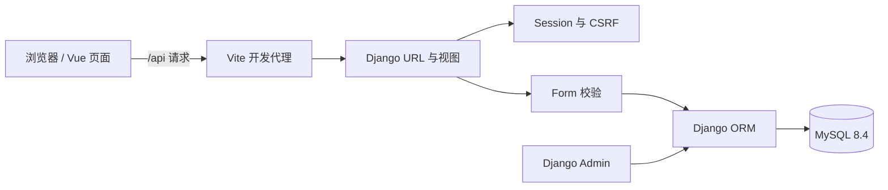

# 架构与代码阅读路线

## 1. 为什么这样搭

本次选择单仓库：`frontend/` 放 Vue，`backend/` 放 Django，`docs/` 放讨论与协作依据。小组能在同一个 PR 中同时检查接口和页面变化。拆成前后端两个仓库需要额外协调版本；微服务／完整容器化应用会增加启动和排错成本，暂不采用。

沿用教学项目 Vue → HTTP/JSON → Django 视图 → Form 校验 → Model／ORM → MySQL 的路径，保留 Django Admin。当前不引入 DRF、Pinia、Redis、Celery 或 Dify 运行环境；等明确需要时再添加。



开发代理只解决本地联调。`npm run build` 生成的文件不会自行携带代理；将来部署需要静态站点与 `/api` 反向代理。这次没有部署到公网。

## 2. 目录与责任

```text
lab/
├─ frontend/
│  ├─ src/api/             请求封装、各模块 API
│  ├─ src/assets/          主题变量与公共样式
│  ├─ src/components/      可复用组件
│  ├─ src/router/          路由入口
│  ├─ src/stores/          简单共享登录状态
│  ├─ src/views/           页面；新功能优先按模块建子目录
│  └─ package-lock.json    npm 锁文件
├─ backend/
│  ├─ config/              settings、全局 urls、WSGI/ASGI
│  ├─ apps/core/           健康检查、JSON 辅助、示例初始化
│  ├─ apps/accounts/       自定义 User、登录接口、Admin
│  ├─ apps/inventory/      模型、校验、接口、测试、迁移
│  └─ manage.py
├─ scripts/               Windows 安装、启动与检查
├─ docs/                  需求、接口、Git 教程和验证
├─ .github/               CI、PR 和 Issue 模板
├─ compose.yml            独立 MySQL 服务与命名数据卷
├─ .env.example           配置说明；真实 .env 不提交
└─ requirements.txt       Python 完整锁定版本
```

`task_plan.md`、`findings.md`、`progress.md` 是本地搭建记录，已忽略；成员应以 `docs/` 中的正式说明为准。

## 3. 一条新增物品请求如何走完

1. `ItemForm.vue` 收集字段并调用 `api/inventory.js`。
2. `api/client.js` 获取 CSRF token，发送带 Cookie 的 JSON POST。
3. Vite 将 `/api/inventory/items/` 代理到 Django。
4. `config/urls.py` → `apps/inventory/urls.py` → `views.items`。
5. 视图检查已登录且 `is_staff`；`ItemForm` 校验必填、数量、编号唯一性和有效期。
6. ORM 在事务中写入 MySQL，返回 201 和创建后的对象。
7. 页面按新编号重新查询，显示后端实际保存结果；失败时保留输入。

Vue 的权限按钮只帮助操作；真正的权限由 Django 每次请求检查。Session 使用 HttpOnly Cookie，代码不把密码或登录 token 保存到 localStorage。所有写接口保留 CSRF 校验。

## 4. 当前模型与权限

- `accounts.User` 继承 Django `AbstractUser`，只补充 `display_name`，从初始迁移就设置 `AUTH_USER_MODEL`，方便将来扩展。
- `inventory.Item` 保存基础台账字段，数量为 Decimal；数据库同时约束唯一编号和非负数量。
- 匿名用户看首页／规划页；登录成员可查物品；`is_staff` 用户可以新增；开发管理员可进 Admin。
- `is_staff` 是本轮技术上的基础权限，**不是最终教师／项目负责人业务角色**。科研项目、实验室隔离和审批权限尚未实现。

现有 Item 适合学习和基础登记。后续应按业务增加批次、独立设备、库存流水、采购单／明细、收货单／明细，而不是不断在 Item 中堆数量状态。

## 5. 后续模块接入方法

例如开发采购：先在 Issue 定义字段、接口与验收，然后新增 `backend/apps/procurement/`，注册 App 与 URL，创建并提交迁移；前端新增 `views/procurement/` 与 `api/procurement.js`，将占位路由换成实际页面。公共 App.vue、路由和 settings 的修改尽量集中协调。

正式出入库需在事务中写业务记录和库存流水，处理并发、重复确认、撤销和审计。Dify 密钥只放后端环境变量；不要把模型直接接到数据库执行权限上。

## 6. 验证与环境

运行依赖由 `requirements.txt` 与 `package-lock.json` 锁定。Vue 3.5.42、Router 5.3.1、Django 5.2.18 延续教学基线；Vite 升至 8.3.8，修复安装检查中报告的问题。

`settings.py` 默认 MySQL，`settings_test.py` 明确限定为内存单元测试。CI 的 backend job 使用真实 MySQL 临时实例与 root 测试账号创建／销毁测试库；这个账号不用于本地日常业务。

上线前另外设计 HTTPS、生产设置、进程托管、日志、登录限流、备份恢复、账号发放和权限策略。本轮默认只绑定本机回环地址。

## 7. 官方参考

- [Vue Quick Start](https://vuejs.org/guide/quick-start.html)：前端工具链起点。
- [Django MySQL 数据库说明](https://docs.djangoproject.com/en/5.2/ref/databases/#mysql-notes)：驱动、字符集及数据库注意事项。
- [GitHub Flow](https://docs.github.com/en/get-started/using-github/github-flow)：基于分支和 PR 的协作流程。
