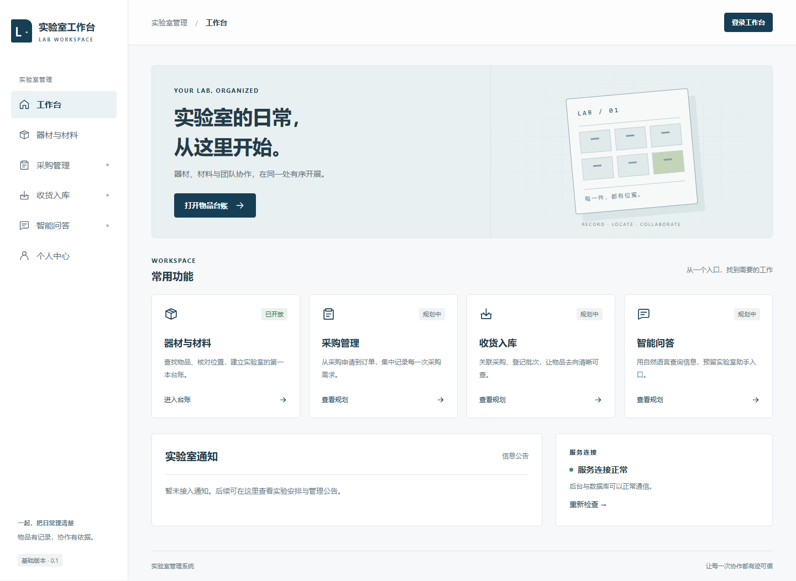
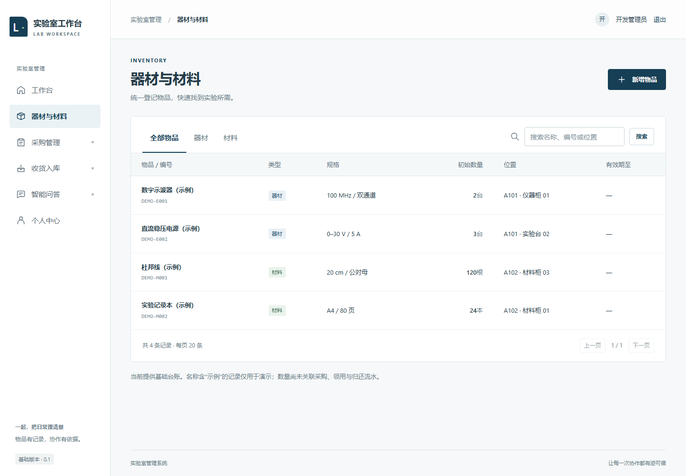

# 基础工程验证记录

验证日期：2026-11-13。本文记录实际执行结果，不代表未来业务已经完成或已部署上线。

| 检查 | 结果与范围 |
| --- | --- |
| 独立 Python 环境 | Python 3.12.14，依赖位于本项目 .venv；pip check 通过 |
| 前端依赖 | npm 安装完成，锁文件已保存；Vite 调整到 8.3.8 后 npm audit 报告 0 个漏洞（仅当次检查结果） |
| Django 检查 | system check 通过，无遗漏迁移 |
| 内存数据库测试 | 9 项通过；SQLite 只用于快速测试 |
| MySQL 测试 | 9 项在独立 MySQL 8.4.13 测试库通过，测试库随后由 Django 销毁 |
| 实际迁移 | accounts、inventory 与 Django 内置迁移全部在 lab_dev 执行成功 |
| 健康接口 | HTTP 200，`{"status":"ok","database":"mysql"}` |
| 前端构建 | Vite 生产构建通过 |
| 浏览器流程 | 未登录跳转、错误密码提示、登录、分类筛选、新增、刷新查询、无结果、个人中心、退出通过 |
| 数量与中文 | 浏览器新增中文材料与数量 2.50，经接口及 MySQL 读取核对一致 |
| 重启持久化 | 关闭并重新启动项目 MySQL 后，浏览器创建记录仍存在；随后只清理本次验证记录 |
| 演示数据 | 保留 4 条明确标注“示例”的记录和本地开发管理员 |
| 页面检查 | 1440px 桌面与 390px 手机截图已检查；导航／浏览器流程无 pageerror，手机无整页横向溢出 |
| Compose 配置 | 通过安装目录的 docker-compose.exe config 校验；本机 Docker 引擎未成功启动，容器运行未在本机验证 |
| GitHub Actions | CI 配置已写好；本次未推送，因此尚无 GitHub 云端检查或 PR 结果 |

9 项后端测试覆盖：数据库健康与失败响应、未登录限制、普通成员禁止写入、管理员保存小数、非法字段不落库、非法 JSON、分类／搜索／页码、真实 CSRF 的登录写入退出流程、错误密码和停用账号。

本机 Docker 故障、备份位置和独立 MySQL 操作见 [本机环境补充](08-local-environment.md)。本次没有修改教学项目和另一个 `lab_intellegence` 项目。

## 当前页面

## 尚未覆盖

没有执行生产部署、外部并发压测或完整无障碍审计；没有实现采购收货事务、库存流转、角色矩阵、科研项目和真实 AI 接口。生产登录限流、备份恢复与安全设置应在部署任务中单独完成。
