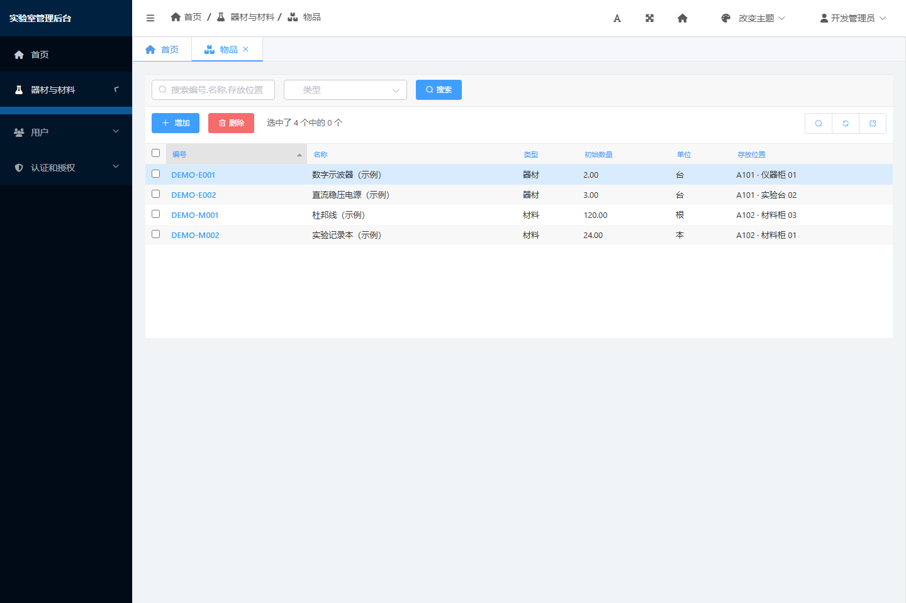

# Django 管理后台与 SimpleUI

后台地址：http://127.0.0.1:8000/admin/ 。使用已有管理员账号登录，开发账号凭据在本机 `.runtime/dev-account.txt`。

后台接入 `django-simpleui==2026.1.13`，与教学项目版本一致。采用 `ant.design.css` 蓝白主题，启用侧栏、标签页和快捷入口，关闭首页宣传信息与登录粒子动画。界面替换后继续使用现有 Django Admin 注册、权限和模型。

## 配置在哪里

| 文件 | 作用 |
| --- | --- |
| `backend/config/settings.py` | 在 Django admin 之前注册 SimpleUI，设置主题、图标和首页选项 |
| `backend/config/simpleui_config.py` | 适配 SimpleUI 启动逻辑，保留同源 iframe 保护 |
| `backend/config/urls.py` | 设置后台名称及 `/admin/` 入口 |
| `backend/apps/core/static/lab/brand.svg` | 本地实验室标识 |
| 每个业务 app 的 `admin.py` | 注册模型，配置列表、筛选、搜索和表单 |

SimpleUI 通过覆盖 Django admin 的模板生效，所以必须注册在 `django.contrib.admin` 前面。此版本会移除 `XFrameOptionsMiddleware`；项目使用自定义 AppConfig 将其恢复，并设置 `X_FRAME_OPTIONS = "SAMEORIGIN"`，让后台自己的标签页可以加载，同源以外的页面不能嵌入。

菜单使用 Django 已注册模型和当前用户权限自动生成。以后在采购 app 的 `admin.py` 注册模型后，具备对应权限的用户就能看到入口，无需另维护一套固定菜单。

## 成员拉取代码后

```powershell
cd D:\lab
.\.venv\Scripts\python.exe -m pip install -r requirements.txt
```

重启 Django，然后刷新后台。本次未修改模型，无新增数据库迁移。浏览器已有旧主题缓存时可强制刷新；若曾手动选过皮肤，可在后台皮肤菜单切回默认主题。

开发环境静态资源由 Django 提供；将来生产部署时需要执行 `collectstatic` 并配置静态文件服务。后台使用本地包内资源。

配置依据：[SimpleUI 官方文档](https://newpanjing.github.io/simpleui_docs/config.html)与项目中安装的该版本源码。

## 实际验证

2026-11-13：Django 检查、迁移检查和原有 9 项后端测试通过。实际浏览器验证登录、首页、物品列表／搜索、新增表单、用户列表和同源 iframe 标签页；无页面脚本错误或失败的资源响应。后台响应保留 `X-Frame-Options: SAMEORIGIN`。


